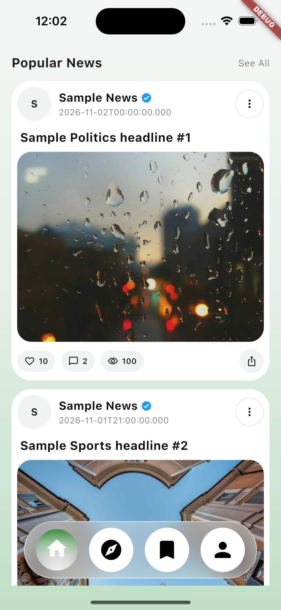
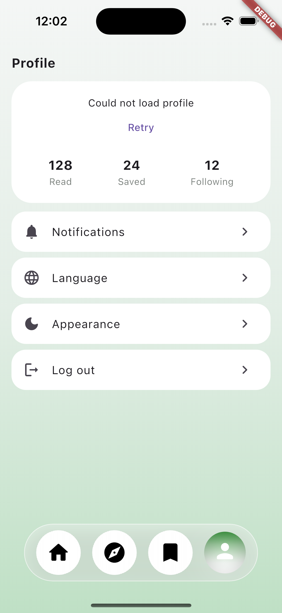
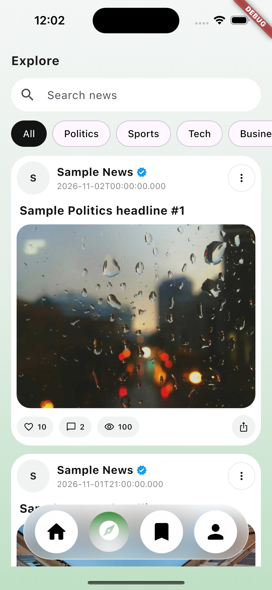
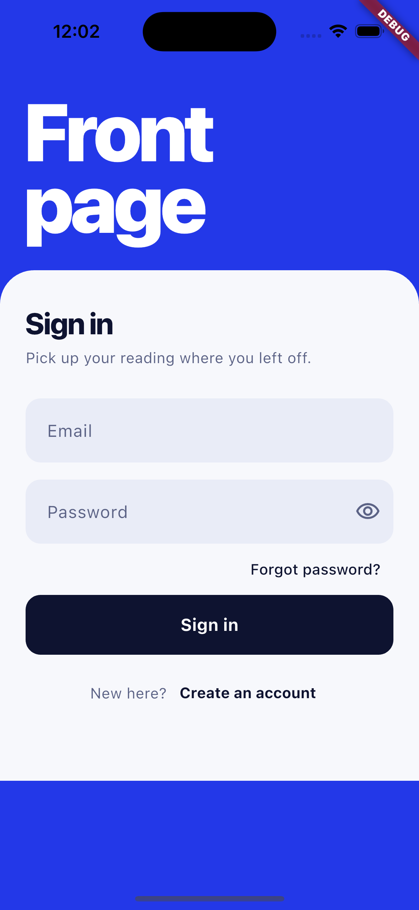

# News Custom Mobile App

## Description

This is a demo app that I built just for fun, to practise and sharpen my
Flutter skills.

> **Note:** Because this is only a demo, I did not set up flavors for
> development, staging and production.

> **Status:** In development.

## Features so far

- login with user passwrod / oauth2 with goolge
- Popular news feed
- Explore with category filter and search
- Article detail page
- Favourites
- Profile

## Screenshots

<p align="center">
  
  
  
  
</p>

## Tech stack so far

| Area | Library |
|---|---|
| State management | `flutter_riverpod` + `riverpod_generator` |
| Routing | `go_router` |
| HTTP | `dio` |
| Secure storage | `flutter_secure_storage` |
| Models | `freezed` + `json_serializable` |

## Project structure

```
lib/
├── core/shared/        # constants, services (http client, local storage)
├── features/
│   ├── auth/           # login, session, auth guard
│   └── news/           # feed, explore, detail, favourites, profile
└── routes/             # app router
```

## Architecture

The app follows Clean Architecture principles:

- **DTOs are separate from entities.** Entities mirror the API response, while
  DTOs are the objects the app (the frontend) uses. If the API changes, only
  the mapping between them changes and the rest of the app keeps working.
- **Every repository has an interface.** The app depends on the interface, and
  the implementation can be written or replaced later.
- **The API integration is easy to swap.** Because the app only knows about
  the interfaces, I can change the API layer without touching the UI or the
  business logic.
